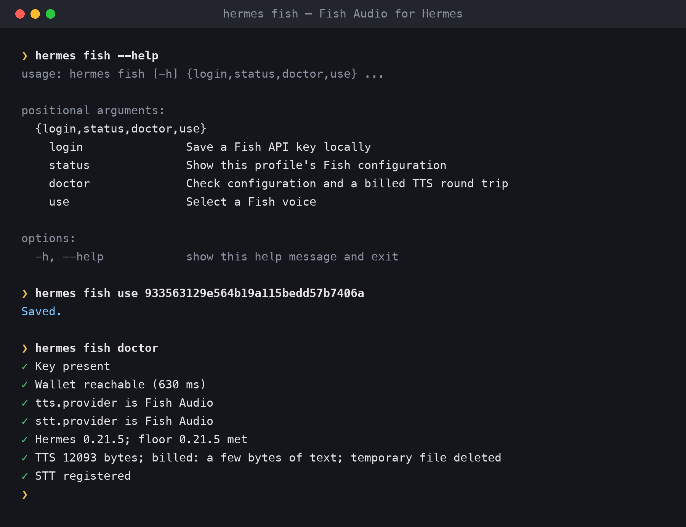
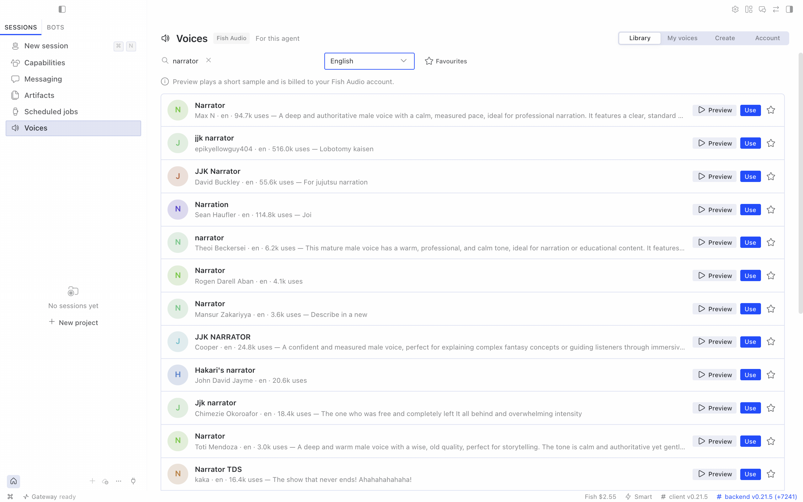
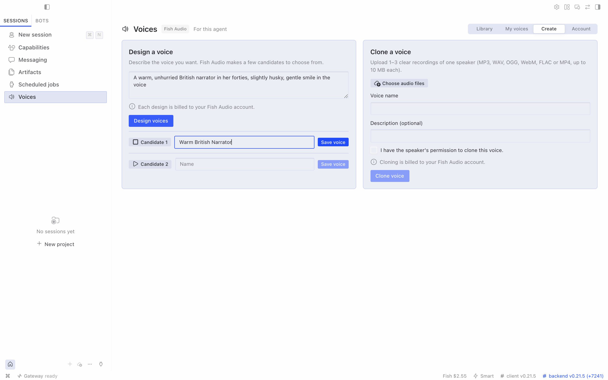
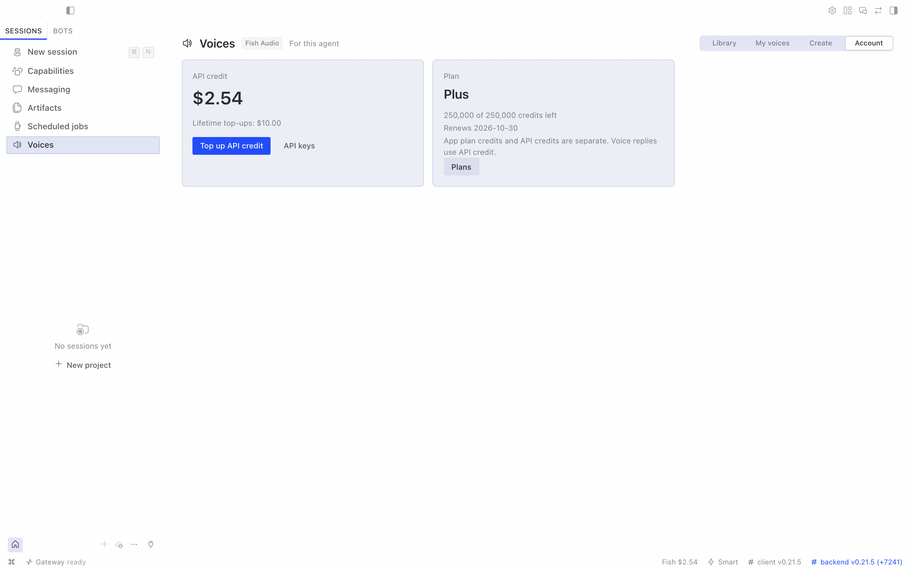

# Fish Audio for Hermes

**Your Hermes agent speaks and listens with Fish Audio: expressive voices in 80+ languages, voice design, live dictation.**

The official [Fish Audio](https://fish.audio) plugin for [Hermes Agent](https://github.com/NousResearch/hermes-agent),
maintained by Electric Sheep. It works in the Hermes CLI, every messaging app Hermes supports and the Desktop app.

[](https://github.com/100yenadmin/fish-audio-hermes/releases/latest)
[](LICENSE)
[](https://github.com/NousResearch/hermes-agent)
[](https://github.com/100yenadmin/fish-audio-hermes/actions/workflows/ci.yml)

```bash
hermes plugins install 100yenadmin/fish-audio-hermes --enable --yes-deps
hermes fish login        # paste your key from https://fish.audio/app/api-keys
```

You need a Fish Audio API key (new accounts can start on Fish's free `s2.1-pro-free` model, free through 30 November
2026). `--yes-deps` installs the plugin's Python dependencies. Then run `/fish setup` in any chat to see what is left.
This line installs the latest release from this repository; `main` only ever holds a tagged, tested release.

The catalog name works too:

```bash
hermes plugins install fish-audio --enable --yes-deps
```

It installs the release pinned in the Hermes plugin catalog. On Hermes 0.23.0 it currently installs an older version,
because Hermes falls back to the catalog copy it shipped with
([NousResearch/hermes-agent#151856](https://github.com/NousResearch/hermes-agent/issues/151856)); check with
`hermes plugins list`. If you already installed it by catalog name and `hermes plugins list` shows an older version,
remove it first (`hermes plugins remove fish-audio`), then run the first line. Installing over it is refused, and
`hermes plugins update` stays on the catalog's pin.

### Try it

1. Install with the first line above, and save your key with `hermes fish login` (or in Desktop: **Voices ▸ Enter API key**).
2. In any chat, send `/fish setup`. It lists what is still missing and the next step, and ends with "Ready. Hear your voice: `/fish preview`".
3. Send `/fish preview`, or ask your agent "Design yourself a voice that fits your personality". You hear a voice reply; previews and voice designs are billed Fish requests.

**Contents:** [What you get](#what-you-get) · [Setup](#setup) · [Use](#use) · [Hermes Desktop](#hermes-desktop) ·
[Configuration](#configuration) · [Disclosure](#disclosure) · [Troubleshooting and reporting a bug](#troubleshooting-and-reporting-a-bug) ·
[Known limitations](#known-limitations) · [Releases](https://github.com/100yenadmin/fish-audio-hermes/releases) ·
[CHANGELOG](CHANGELOG.md) · [CONTRIBUTING](CONTRIBUTING.md) · [License](LICENSE)

`--yes-deps` installs the plugin's Python dependencies without asking. Without it, Hermes 0.21.6 and newer asks
first, and an install with no terminal (a script, or an agent installing the plugin for you) leaves Fish Audio
installed but disabled. Hermes 0.21.5 installs them without asking and has no `--yes-deps` flag, so leave it out there. On either version,
`hermes plugins enable fish-audio` afterwards also installs them.

`hermes fish login` checks the key against your Fish account and saves it to the active profile. It makes Fish
Audio the speech and transcription provider where none is set, and replaces another provider only if you confirm
at the prompt or pass `--yes`. Once Fish Audio is the provider, voice replies,
read-aloud and voice notes go through it.

## What you get

| | |
|---|---|
| **Expressive speech** | Fish Audio S2 models follow emotion and delivery cues such as `[excited]`, `[whispering]` and `[laughing]`. Drama 3 (`drama-3`) takes plain-language direction and word-level tags such as `<whisper>…</whisper>`. Multi-speaker dialogue and custom pronunciations are supported too. |
| **Streaming voice** | CLI voice mode and Desktop voice replies stream each sentence as it is ready. In our tests the first audio bytes arrived 0.24–0.38 s after a sentence was sent (see [Streaming voice](#configuration) for how this was measured). |
| **Voice library** | Search Fish Audio's community voices from chat (`/fish voices narrator`) and switch with `/fish use <id>`. |
| **Voice names** | Save a voice under a short name in any script (`/fish alias add 猫 <voice id>`), then use the name wherever a voice id goes: `/fish use 猫`, `/fish preview 猫` or `fish_speak`. |
| **Your own voices** | Clone a voice from a short sample, or describe one in words and pick from the candidates. Cloning and deleting from chat go through Hermes's approval gate, so by default Hermes asks you first. |
| **Speech-to-text** | Voice notes use `transcribe-1-pro`. Live dictation uses native realtime (Preview) for word-by-word captions without sound or speaker tags in CLI voice mode, TUI and Desktop (Hermes 0.21.6+). `fish_transcribe` adds speaker turns, timestamps and SRT subtitles. |
| **Desktop Voices page** | In Hermes Desktop: browse and preview voices, pick one for the agent, clone or design your own, and check your credit. |
| **Account at a glance** | `/fish balance` shows your API credit and plan. When credits run out, tools and `/fish` commands reply with a top-up link; for voice replies, `/fish status` shows the last error. |

## Setup

Run `/fish setup` from chat, follow its next step until Ready, then hear a short billed sample with `/fish preview`.

1. **Get a key** at <https://fish.audio/app/api-keys>. New accounts can start on Fish's free `s2.1-pro-free` model, free through 30 November 2026;
   after that, add API credit.
2. **Add it** with `hermes fish login` on the machine running Hermes, or in Desktop: **Voices ▸ Enter API key** opens
   the key field in Settings ▸ Plugins ▸ Fish Audio ▸ Agent settings (on older Desktop, open it with the gear on the
   fish-audio row in Capabilities ▸ Plugins). Or use
   `hermes tools` ▸ Text-to-Speech ▸ Fish Audio. `login` checks the key against your Fish wallet and saves it to the
   active profile. It makes Fish Audio the speech and transcription provider where none is set; it replaces another
   provider only if you confirm at the prompt or pass `--yes`. `--key-stdin` reads the key from standard input.
3. **Check it** with `hermes fish doctor`, which makes one short billed synthesis (`--no-synth` skips it). A key saved in Desktop's
   Agent settings field works right away; after `hermes fish login` or `hermes tools`, restart a running gateway or the
   Desktop app to pick up the new key.

Never paste API keys into a chat. `/fish` refuses them and tells you to rotate the key.



## Use

**In conversation:** just ask.
- "Read that back to me in an excited voice."
- "Find me a deep British narrator voice and use it."
- "Design a voice for our support agent and let me pick."
- "Transcribe meeting.m4a with speakers and give me subtitles."

**Commands**

| Command | What it does |
|---|---|
| `/fish setup` | Free profile checklist with the next setup step and a link to the spoken preview |
| `/fish status` | Key, providers, voice, model and why it was chosen, credit, last error |
| `/fish voices [query]` | Search the voice library |
| `/fish use <voice-id, name or own title>` | Use a voice for this profile; a unique title of your own voice works too |
| `/fish model <id>` | Pick a model (`s2.1-pro`, `s2.1-pro-free`, `s2-pro`, `s1`, `drama-3`) |
| `/fish preview [voice-id, name or own title] [text]` | Hear the current voice or a chosen voice (a billed synthesis); use a single-word title for previews |
| `/fish alias` | List your saved voice names |
| `/fish alias add <name> <voice-id>` | Save a name for a voice: 1–32 letters (any script), digits, marks, `-` or `_`, starting with a letter |
| `/fish alias remove <name>` | Delete a saved name |
| `/fish balance` | API credit and plan |
| `hermes fish login [--key-stdin] [--yes]` | Save and check a key, offer to switch providers |
| `hermes fish status` · `hermes fish use <voice-id, name or own title>` | Status and voice choice from your terminal |
| `hermes fish doctor [--no-synth]` | Check the setup with one billed synthesis, or without it |

**Model tools** (toolset `fish_audio`; synthesis, transcription, cloning and design are billed)

| Tool | What it does |
|---|---|
| `fish_speak` | Expressive or multi-speaker speech; with `timestamps: true`, word timings plus SRT and WebVTT subtitles |
| `fish_voices` | Search, list and inspect voices; clone, design, save, update and delete them |
| `fish_transcribe` | Rich transcription with speakers, timestamps and SRT |
| `fish_settings` | Check or set this profile's Fish voice, model, reading speed and saved names; `set_speed` accepts `speed` 0.5–2.0 or `null` to reset; `get` returns `speed`; free |
| `fish_account` | Balance/plan, dated model prices and offline cost estimates; free |
| `fish_pronunciations` | Create, publish, inspect and select reusable pronunciation dictionaries; free; deletes require approval |

Plain read-aloud uses Hermes's own `text_to_speech` tool, with Fish Audio as the provider. Include the
`media_tag` that `fish_speak` returns in the reply to deliver its audio; the plugin also appends missing audio tags
through its output hook. Plugin skills: `fish-audio:fish-audio-setup`, `fish-audio:fish-audio-expressive-speech`,
`fish-audio:fish-audio-voice-studio` and `fish-audio:fish-audio-report-problem` (drafts a bug report and files it with
`gh` only after you approve the draft).

To remember recurring company names, use `fish_pronunciations`: `create` with a `name`, then `publish`
with the returned `dictionary_id` and `rules` such as `[{"key":"ES","value":"Electric Sheep","type":"alias"}]`.
Each version is the **complete** rule list. Publish fetches the latest version first unless you supply
`expected_latest_version_id` (null for the first version); on a conflict, fetch, merge and publish again.
Use `get`, `versions` and `get_version` to inspect dictionaries and their rules. `list` and `versions`
accept `cursor` or `page`, `page_size` and `include_total`.
Set `use` with `refs: [{"id":"DICTIONARY_ID","version":"VERSION_ID"}]` to save up to three defaults for
this profile's ordinary voice replies and `fish_speak`; `refs: []` clears them. Explicit version IDs stay
pinned when you publish an update. For one speech call, `fish_speak` accepts `dictionaries` with the same
references; `dictionaries: []` drops the defaults. References are checked before use or per-call speech.
A `fish_speak` call cannot pass both `dictionaries` and per-call `pronunciations` or `spoken_as`: publish those
words into a version, or leave out `dictionaries`. Per-call words replace configured references for that call (as
before), and configured inline dictionaries still merge with per-call words.
`delete` and `delete_version` use Hermes approval; the latest version cannot be deleted.

## Hermes Desktop



The Voices page follows Hermes Desktop's display language: English, Simplified Chinese (`zh`), Traditional Chinese
(`zh-hant`), Japanese (`ja`), Arabic (`ar`), Russian (`ru`), French (`fr`), German (`de`) and Spanish (`es`).
Changing the display language updates the page, sidebar, status bar and command palette without a reload.
Fish Audio errors and the page's own messages are translated too, keeping the request id and Fish trace; numbers
and amounts use the language's own formats.
The translations are machine-authored and checked against Hermes Desktop's own wording; native-speaker corrections
are welcome as pull requests to `devtools/src/desktop/locales/`.

The plugin adds a **Voices** page to Hermes Desktop for the selected agent:

- **Library:** search Fish Audio's voices by name and language, preview them (a short billed sample), star
  favourites, and choose **Use** to make a voice the agent's voice.
- **My voices:** the voices you cloned or designed; edit a voice's title and description, or delete one by typing its name.
- **Create:** clone a voice from 1–3 recordings (up to 10 MB each, with the speaker's permission), or describe a
  voice and save the candidate you like.
- **Account:** API credit, plan credits and top-up links. The status bar shows your API credit, in orange when it
  runs low.

| Create | Account |
|---|---|
|  |  |

The page has two halves in one package: routes that run **on the agent's gateway** and screens that run **in
Hermes Desktop**. On the same computer, where Desktop and the agent share a Hermes home (the usual local install),
Desktop picks up the desktop half by itself after the CLI install. Open **Capabilities → Plugins → Fish Audio**,
switch on **Desktop**, and restart the gateway once.

For Desktop connected to an agent on another machine, install from Desktop:

1. Open **Capabilities → Plugins → Install from Git**, enter `https://github.com/100yenadmin/fish-audio-hermes`,
   choose **Review repository**, then **Install**. Desktop installs the agent half into the connected agent and
   the desktop half on this computer.
2. On Desktop 0.21.7 and newer, **Install** with **Enable after install** also switches on the desktop half. On
   older Desktop, open **Fish Audio** in **Capabilities → Plugins** and switch on **Desktop**.
3. **Restart the agent's gateway** once. Hermes mounts plugin routes only at startup.

The **Voices** row appears only
for agents whose gateway has the plugin; an agent without a Fish Audio key shows a card that links to the key page
and the plugin's settings.

### Settings page (Hermes Desktop 0.21.6 and newer)

**Settings ▸ Plugins ▸ Fish Audio** shows the selected agent's voice, speech model, reading speed and saved voice names, and lets you
change them. **Reading speed** ranges from 0.5× to 2.0× in steps of 0.05; choose **Save speed** to apply it to voice replies,
read-aloud and streaming. **Reset** removes `tts.fish-audio.speed`, returning to 1.0×. Operator-managed settings stay locked.
**Change** opens the Voices page to pick a voice. The plugin's own options (API key, server address,
streaming and transport) sit under the same entry as **Agent settings**.

The page acts on the agent selected in Desktop. Its header names that agent, or says "this agent" for the default
profile. Desktop's own **Settings ▸ Voice** doesn't list plugin speech providers or their voices yet
(NousResearch/hermes-agent#136485), so pick Fish voices here or on the Voices page. Desktop 0.21.5 has no plugin
settings pages; use the Voices page and `/fish` there.

## Configuration

All settings are per profile.

| Setting | Where | What it does |
|---|---|---|
| Voice | `tts.fish-audio.voice`; `/fish use`, the Voices page, the settings page, `fish_settings` | A Fish voice id. `/fish use`, the pages and `fish_settings` also take a saved name or one of your own voice titles and save its id. Unset: Fish's default voice. |
| Model | `tts.fish-audio.model`; `/fish model`, the settings page | `s2.1-pro`, `s2-pro`, `drama-3`, `s1` (deprecated) or `s2.1-pro-free`. Unset: chosen from your wallet (see "Which model?"). |
| Reading speed | `tts.fish-audio.speed`; the settings page, `fish_settings set_speed` | 0.5–2.0, default 1.0. A per-call speed wins. |
| Pronunciation dictionaries | `tts.fish-audio.pronunciation_dictionary`; `fish_pronunciations use` | Up to three pinned dictionaries for ordinary voice replies. |
| Streaming | `plugins.entries.fish-audio.settings.streaming` | `auto` streams sentence by sentence on Hermes 0.21.6+; `"off"` uses whole-file speech. |
| Live dictation | `stt.streaming: true`; `live_transcription` | `realtime` (Preview, word by word) or `compat` (phrase captions). |
| Free-model policy | `allow_free_model` | `false` never uses `s2.1-pro-free`, even when named. |
| API endpoint | `base_url` | Fish's API by default; any https URL, or http on loopback, for a self-hosted endpoint. |
| Operator mode | `operator_account` | The operator manages the key and billing; the agent hides amounts and account links. |

 Set `tts.fish-audio.language: es-MX` (or pass `language` to `fish_speak`) for number, date and unit spelling and word timestamps; it never changes the voice, accent or audio quality.

```yaml
tts:
  provider: fish-audio
  fish-audio:
    voice: 933563129e564b19a115bedd57b7406a   # any Fish voice id (this one: "Sarah", a conversational narrator)
    model: s2.1-pro                           # optional; see "Which model?"
    latency: balanced                         # normal | balanced | low
    temperature: 0.7
stt:
  provider: fish-audio
  streaming: true              # live dictation on Hermes 0.21.6+
  fish-audio:
    model: transcribe-1-pro
plugins:
  entries:
    fish-audio:
      settings:
        streaming: auto        # auto | "off"
        live_transcription: realtime # realtime (Preview) | compat
        allow_free_model: true # false = never use s2.1-pro-free
```

The `plugins.entries.fish-audio.settings` keys (`base_url`, `streaming`, `transport`, `allow_free_model`,
`live_transcription`, `operator_account`) and the API key also appear in Desktop ▸ Settings ▸ Plugins ▸ Fish Audio ▸ Agent settings (on
older Desktop, the gear on the fish-audio row in Capabilities ▸ Plugins). Set the voice and model from the Fish Audio settings page, the Voices page, `/fish use` or
`/fish model`. Saved voice names live in `tts.fish-audio.aliases` (name → voice id). On a managed agent, when the
operator sets the voice, model or names, the plugin says so instead of saving.

**Which model?** A valid `tts.fish-audio.model` is used as set (for `fish_speak`, a model named in the call comes
first); invalid ids are ignored. Otherwise the plugin uses `s2.1-pro`, and picks `s2.1-pro-free` only when Fish
reports a wallet with no API credit and no past top-ups that doesn't carry Fish's free-credit flag. If the wallet can't be read, it uses
`s2.1-pro`. Before 1 November 2026, its free-model notice says the model is free until 30 November 2026 and that
Fish Audio may use free-tier requests to improve its models; during November it adds a reminder to add API credit to keep speaking.
After 30 November it describes the announced end and suggests adding credit if speech fails, without changing the model sent.
`allow_free_model: false` replaces `s2.1-pro-free`
with `s2.1-pro` everywhere, even when you name the free model yourself.

**Streaming voice.** With `tts.provider: fish-audio` on Hermes 0.21.6 or later, which has the plugin streaming hook,
the plugin streams 24 kHz PCM from `POST /v1/tts` to CLI and TUI voice playback, Desktop read-aloud and gateway
streaming. Hermes 0.21.5 uses whole-file synthesis instead: sentence by sentence in CLI voice mode, and the whole reply
in Desktop read-aloud and gateway voice. That includes the Desktop app and Termux builds still on 0.21.5. They stream
once they update; the plugin needs no change.
Each streamed sentence is one billed request. A sentence Fish turns away before sending any audio (busy, or a temporary 500/503) is retried, up to three attempts in all; once audio has started it is never retried, so nothing is spoken or billed twice. Measured first audio bytes: Fish HTTP API p50 243 ms (3 samples, 238–356
ms), CLI voice mode 373–381 ms, Desktop speak-stream handler 310 ms (in-process, not through the Electron UI);
these exclude the model's own reply time. Set `streaming: "off"` for whole-file speech; `transport: ws` switches to Fish's live
WebSocket for diagnosis.

Under host plugin isolation (`plugins.isolation: host`, newer Hermes builds), the `hermes fish` terminal command is
unavailable and voice replies use whole-file speech instead of streaming; `/fish`, the tools, the hooks and
both providers still work. Config changes apply to the active profile; managed installs may refuse writes.

### Live dictation

On Hermes 0.21.6 or newer, set `stt.provider: fish-audio` and `stt.streaming: true`. Live dictation works in CLI
voice mode, the TUI and Desktop dictation (the composer mic). Native realtime STT (`transcribe-stream-1`, Preview)
is the default, with word-by-word draft captions. Sound tags and speaker tags are removed; the final text joins
all committed turns. Any doubt about completeness makes Hermes transcribe the recording as a file instead,
including a degraded turn, an early close or no final answer within 15 seconds of stopping.

The session opens with the first audio and closes once Fish confirms the last words, usually about a second after
you stop; if Fish never confirms, the plugin stops waiting after 15 seconds (a recording Hermes cancels or discards
closes 30 seconds after its last audio, because Hermes gives the plugin no cancel signal). Fish bills $0.36 per hour
of open session, per second, including silence and that final wait (about $0.001 for a 10-second dictation plus its
final second). Microphone PCM streams to
`wss://api.fish.audio/v1/asr/realtime`. Set `plugins.entries.fish-audio.settings.live_transcription: compat` to use
the old ElevenLabs-compatible endpoint with phrase captions and billing per committed phrase.
Remote self-hosted endpoints and plugin-host isolation keep file transcription; a loopback `base_url` receives
live audio. Language and prompt hints are ignored on both endpoints.

`transcribe-1` is deprecated and retires on 2026-12-31; from then requests use `transcribe-1-pro` at the same price.
Choose `transcribe-1-pro`. The plugin never rewrites your configured model.

### Operator-managed keys

Set `plugins.entries.fish-audio.settings.operator_account: true` (Desktop: **Operator-managed account**) when the
Fish account belongs to the agent operator. This hides balance, plan, billing and API-key links in chat and Desktop, and directs
setup or credit problems to the operator. Because one operator account can serve many agents, the account's own
voices aren't listed, edited or deleted from an agent (no My voices tab; `fish_voices` refuses `update` and
`delete`). Instead, `fish_voices action:"mine"` lists only this profile's saved-name voices, with details for up to
20 voices; unavailable details leave the name and id. Cloning and saving a design automatically add a saved name
derived from the title when possible; otherwise the result explains why the operator needs to add one.
A voice created on the Voices page also goes into that agent's Favourites. Operator mode defaults to false.
`fish_speak` and `fish_transcribe` results include a `usage` object with the model and billable UTF-8 bytes or audio
seconds. Operator mode hides USD estimates and a wallet-chosen default model; personal accounts also get a USD
estimate when available. If usage cannot be computed, the completed job is returned without it.
Tool descriptions update after a gateway restart.
Operators should also pin `tts.fish-audio.model` or set `allow_free_model: false`, so the model never depends on
the wallet that users can't see.

## Privacy and security

- **No telemetry.** The plugin talks only to Fish Audio's API (`api.fish.audio`, or the `base_url` you configure),
  and only for the work you ask for. See [SECURITY.md](SECURITY.md) for exactly what each request carries. Links to
  Fish Audio are plain links, with no tracking parameters.
- **Keys** come from the active profile's secret scope. When one Hermes process serves several profiles, each
  profile uses its own key; a single-profile install may also read `FISH_API_KEY` from the environment. Keys are
  never logged or put in error messages.
- **Voice fields:** search accepts `author_id`, `title_language` and `licensed`, and returns boolean `has_more`.
  Design accepts `num_step` (1–128), `guidance_scale` and `instruct_guidance_scale` (finite, ≥ 0). Clone/update
  accept private/unlist `visibility` and `cover_image_path` (PNG/JPEG/WebP, ≤ 5 MiB); clone also accepts boolean
  `generate_sample`. Transcription returns `language` when Fish supplies a string.
- **Files** the model tools upload (`fish_voices` clone samples, `fish_transcribe` recordings) must be regular audio
  files (covers must be images). They refuse symlinks, Hermes config and secret files, and SSH or cloud credential paths.
- **Approvals:** cloning and deleting voices, and deleting pronunciation dictionaries or historical versions,
  from chat or the model tools go through Hermes's approval gate and
  follow your Hermes approval settings. By default Hermes asks you, and refuses when no one is there to answer. The
  Desktop Voices page confirms them on the page instead (see [Disclosure](#disclosure)).
- Report vulnerabilities privately; see [SECURITY.md](SECURITY.md).

## Disclosure

- Synthesis, transcription, cloning and voice design are paid Fish Audio requests billed to your Fish account (except
  `s2.1-pro-free` while Fish offers it free, announced through 30 November 2026).
- `fish_account balance` reads the wallet and plan like `/fish balance`; `models` and `estimate` work offline.
  `fish_settings` and `fish_account` have no Fish charge. Before a long or Drama 3 job, ask for `fish_account estimate`.
- `fish_pronunciations` management calls are free. They send dictionary names, descriptions, rules and IDs to Fish.
  `use` saves verified version references in this profile's `tts.fish-audio.pronunciation_dictionary`; speech sends those references.
  Operator-managed agents refuse listing, creating, publishing and deleting dictionaries (they belong to the operator's whole account); reading a known dictionary or version and choosing unmanaged profile defaults remain available.
- Fish Audio may use free-model requests to improve its models.
- With live dictation on (`stt.streaming: true`), microphone audio streams to `api.fish.audio` while you speak,
  through native realtime (Preview), billed $0.36 per hour of open session, per second; `live_transcription: compat`
  uses the old endpoint billed per committed phrase. Sessions open with the first audio and close once Fish confirms the last words (usually about a second after
  you stop; the plugin stops waiting after 15 seconds), or 30 seconds after the last audio of a cancelled recording.
  If a live session fails or returns no text, Hermes transcribes the recording as a file instead, a separate billed
  request.
- The plugin sends your key and the text, audio, file names, voice details and cover images you ask it to process to
  `api.fish.audio` (or the `base_url` you configure), reads your wallet for balance and model choice, stores your key
  in Hermes's `.env`, and collects no telemetry. [SECURITY.md](SECURITY.md) lists what each request carries.
- It writes the profile's Fish voice, model and saved voice names (up to 50) to `config.yaml` when you use
  `fish_settings`, `/fish use`, `hermes fish use`, `/fish model`, `/fish alias`, the settings page or the Voices page; choosing a voice
  also makes Fish the speech provider when none is set. `hermes fish login` checks a key against your Fish wallet
  before saving it, and sets the speech and transcription providers only when they are unset or you confirm.
- **Report-a-problem skill:** when you say Fish Audio is broken or ask to report a problem, the agent runs
  `hermes fish doctor --no-synth`, `/fish status`, `hermes --version` and `hermes plugins list --json`, and reads
  recent Hermes log lines that mention Fish (`hermes logs --since 1h -n 2000 | grep -i fish`). It searches this
  plugin's GitHub issues for two or three key words (with your `gh` login, or a web tool without one), keeps the
  search words and the draft in small local files, and files a public issue or comment only after you approve the
  exact text. A billed reproduction runs only with your OK. Reports leave out keys, credit amounts and voice ids not
  confirmed as public library voices; security problems go to the repository's private advisory form instead.
- **Voice-studio skill:** when you ask for a voice that fits the agent, the agent reads its SOUL.md or persona and
  sends Fish a one- or two-sentence voice description (never the whole persona) and a short sample text, as a billed
  design of three candidates.
- The Desktop Voices page adds gateway routes under /api/plugins/fish-audio/, behind the Hermes dashboard's
  existing authentication. On that page, previews, clones and voice designs are billed; cloning a voice or saving a
  designed one creates a voice in your Fish account; cloning and deleting are confirmed on the page (a
  speaker-consent box, a typed voice name) instead of through Hermes's approval gate; and Use sets the
  profile's Fish voice, and its speech provider when none is set. Preview and design audio files are deleted
  from the gateway once returned; a design's audio is held in gateway memory so you can save it, until it is
  saved, a later design or save finds it over an hour old, or the gateway stops; clone uploads are deleted
  after the clone, or by the next upload once idle for 15 minutes. With a key set, Desktop reads your Fish
  wallet when an agent is selected and about every five minutes, for the status-bar credit; favourites stay in
  Desktop's plugin storage on that computer, and fetched previews stay in the window's memory until it closes.

## Compatibility

Hermes Agent 0.21.5 or newer, Python 3.11+, macOS and Linux. Streaming voice and live dictation need 0.21.6 or newer. CI tests the
plugin against Hermes 0.21.5 (the floor), 0.21.6 (the catalog floor), the latest Hermes release, Hermes `main` and the
Electric Sheep fork. Windows is untested. CI also runs Python 3.14.

### Performance

Measured on 2026-10-11 from Tokyo with plugin v1.3.2, N=3, p50: HTTP streaming time to first audio was
0.293 s on s2.1-pro, 0.266 s on s2-pro and 0.244 s on s1. Whole-file MP3 synthesis of 310 characters took
3.605 s on s2.1-pro and 2.209 s on s2-pro. On a clean synthetic speech corpus, transcribe-1-pro had English
word error rate (WER) 1.8% and Japanese/Chinese character error rate (CER) 0. These numbers depend on region and load.

## Fish Audio's MCP server and this plugin

This plugin is Hermes's speech provider and uses a developer API key, billed to Fish API credit.
Fish's remote HTTP MCP server uses browser sign-in (OAuth, no API key) and is billed to your Fish plan's package credits.

Which to use:

- Speech replies, voice notes, dictation, the Desktop Voices page and the `fish_speak`, `fish_voices` and
  `fish_transcribe`, `fish_settings`, `fish_account` and `fish_pronunciations` tools: this plugin. An MCP server cannot be Hermes's speech provider.
- Story Studio audiobooks and podcasts, images and video: Fish's MCP server.

In Hermes 0.21.7 or newer, add the MCP server with:

```sh
hermes mcp add fish-audio --url https://api.fish.audio/mcp --auth oauth --connect-timeout 180
```

Hermes opens Fish's sign-in page: choose the team whose credits to use, then allow access. Fish may email a 6-digit
code first, and Hermes waits only 30 seconds for the sign-in unless you pass `--connect-timeout`.
`hermes mcp login fish-audio` signs in again later.
Ask for each piece of speech through one tool only.
Fish's [official plugin](https://github.com/fishaudio/fish-audio-plugin) connects Claude Code, claude.ai, Codex and ChatGPT to its MCP server.
[Fish Audio voice agents (phone agents)](https://docs.fish.audio/agents/overview) are not in this plugin.

## Troubleshooting and reporting a bug

| Message | Fix |
|---|---|
| "Fish Audio isn't set up for this profile" | `hermes fish login` |
| "Top up Fish Audio API credits" | Top up at <https://fish.audio/app/developers/billing>. Plan credits and API credits are separate. |
| "Fish Audio concurrency limit reached" | Fish allows 5 concurrent requests below $100 of lifetime top-ups, 15 from $100, and 50 from $1,000. |
| "The voice id was not found" | The id is wrong or the voice is private to another account. Try `/fish voices`. |
| Voice replies stay silent | Run `/fish status`; it shows the last Fish error, with its Fish trace id when Fish sent one. |
| Fish tools missing after turning the plugin off and on (Hermes 0.21.6 and older) | Add them back with `hermes tools`. Hermes 0.21.7 and newer restore them. |
| Anything else | Run `hermes fish doctor --no-synth`; when speech itself fails, plain `hermes fish doctor` adds one short billed synthesis. Quote the Fish trace id from the error when you contact Fish Audio support. |

Run `hermes fish doctor --no-synth` to check setup without billed synthesis; it can read Fish account metadata.
Use `/fish status` for key presence, providers, voice, model, credit and the last failure; operator-managed accounts hide credit.
Under plugin-host isolation the terminal command is unavailable, so use `/fish status`.
Plain `hermes fish doctor` makes a billed synthesis; only run it with the user's OK.
Ask your Hermes agent to "report a problem with Fish Audio": it drafts a report and files nothing until you approve the draft.
On Hermes older than 0.21.6, plugin skills are not in the agent's system prompt; ask the agent to load the skill
`fish-audio:fish-audio-report-problem` by that name (it appears in `skills_list`).
Use the [bug report form](https://github.com/100yenadmin/fish-audio-hermes/issues/new?template=bug_report.yml), with versions and short, redacted logs.
Report security problems through the [private advisory form](https://github.com/100yenadmin/fish-audio-hermes/security/advisories/new).

Releases and notes: [Releases](https://github.com/100yenadmin/fish-audio-hermes/releases) · [CHANGELOG](CHANGELOG.md). To contribute, see [CONTRIBUTING](CONTRIBUTING.md).

## Known limitations

In Hermes Desktop voice conversations, part or all of a reply sometimes goes unspoken because Desktop stops passing it
to speech mid-turn. This affects every speech provider; fixes are proposed
([NousResearch/hermes-agent#129305](https://github.com/NousResearch/hermes-agent/issues/129305)).

An empty API key field in Desktop Settings is hard to see, worst in the dark theme; a fix is proposed
([NousResearch/hermes-agent#138994](https://github.com/NousResearch/hermes-agent/issues/138994)).

Native live dictation is Preview, with word-by-word drafts; `live_transcription: compat` keeps phrase captions. It covers the composer mic,
CLI voice mode and TUI; Desktop voice conversations and messaging voice notes keep file transcription. Remote
self-hosted endpoints, Hermes 0.21.5 and plugin-host isolation also keep file transcription.

The auto-append fallback is per session. Mid-turn context compression can drop that fallback;
the model normally includes the returned `media_tag` itself.

Core gives plugins a `.mp3` path for plain `text_to_speech` and re-encodes it to Opus for voice bubbles
([upstream #133133](https://github.com/NousResearch/hermes-agent/issues/133133)). Core's text normaliser
also alters `<|speaker:N|>` markup and Drama 3 closing tags such as `</whisper>` on that path: use `fish_speak` for
multi-speaker speech and Drama 3 word tags
([upstream #133131](https://github.com/NousResearch/hermes-agent/issues/133131)).

## License

Apache-2.0. Maintained by [Electric Sheep](https://github.com/100yenadmin) with the Fish Audio team.
Fish Audio is a trademark of Hanabi AI Inc.

## Development
Weekly regression alarm: see [bench/README.md](bench/README.md).

Run JavaScript tooling from `devtools/`: `cd devtools && npm ci && npm run typecheck && npm test`.
`npm run check:bundle` checks the committed `desktop/plugin.js`; `npm run build` rebuilds it.
